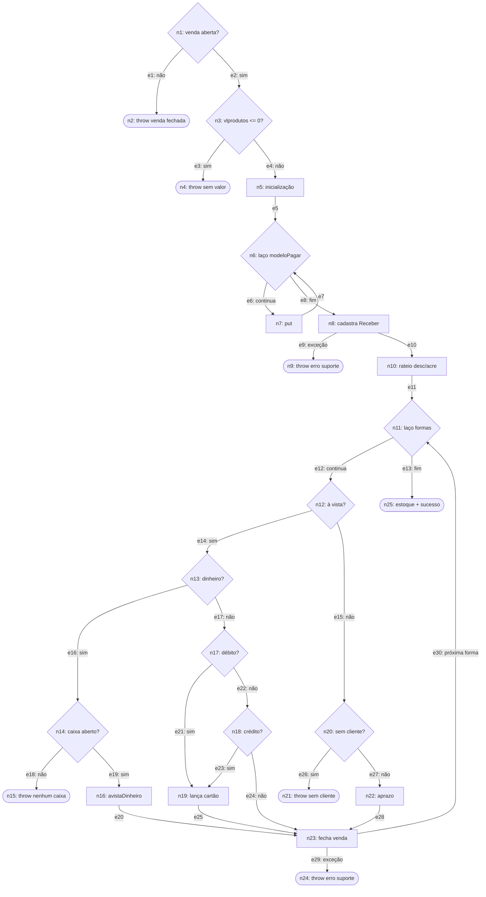

# Teste estrutural e teste de mutação — `VendaService`

**Responsável:** Felipe Martins Bittencourt
**Entrega 2, Etapas 3 e 4.** Decisões registradas em
[`docs/ai/decisoes-entrega2-venda.md`](ai/decisoes-entrega2-venda.md) (D-16 e D-17).

> Este é o rascunho. A versão oficial vai para o Google Docs do grupo, nas
> seções de teste estrutural e de teste baseado em defeitos.

## Resumo

| Critério | Meta | Antes (testes da Entrega 1) | Depois (Etapas 1 e 2) |
|---|---|---|---|
| Todas-arestas (ramos no JaCoCo) | 80% ou mais | 97% (37/38) | **100% (38/38)** |
| Linhas | — | 98% (124/126) | **100% (126/126)** |
| Escore de mutação (PIT, operadores DEFAULTS) | 80% ou mais | 79% (52/66) | **91% (60/66)** |
| Escore de mutação sem os equivalentes | — | 79% (52/66) | **100% (60/60)** |
| Testes em `VendaServiceTest` | — | 32 | 53 |

**Ferramentas:** JaCoCo 0.8.11 e PIT 1.15.8, rodados em Java 8 no container do
projeto. "Antes" é o código de teste do commit `325d7ac`, ainda sem mudanças da
Entrega 2, rodado numa cópia temporária. "Depois" é o código atual da branch
`test/venda-service-entrega2`.

**Evidências** em [`docs/evidencias/entrega2/`](evidencias/entrega2/):

| Evidência | Antes | Depois |
|---|---|---|
| JaCoCo, cobertura por método | `baseline/jacoco-VendaService-metodos-baseline.png` | `depois-testes/jacoco-VendaService-metodos.png` |
| JaCoCo, código de `fechaVenda` (losango amarelo = aresta não percorrida) | `baseline/jacoco-VendaService-codigo-baseline.png` | `depois-testes/jacoco-VendaService-codigo.png` |
| PIT, resumo | `baseline/pit-VendaService-baseline.png` | `depois-testes/pit-VendaService.png` |
| PIT, lista de mutantes (verde = morto, vermelho = vivo) | `baseline/pit-VendaService-mutantes-baseline.png` | `depois-testes/pit-VendaService-mutantes.png` |

---

# Parte 1 — Teste estrutural (critério todas-arestas)

## 1.1 Critério e forma de medição

O critério **todas-arestas** exige que cada aresta do grafo de fluxo de
controle (GFC) seja percorrida por pelo menos um teste. Uma aresta é cada
transição possível entre dois blocos de código.

O JaCoCo não desenha o GFC, mas mede duas coisas que juntas equivalem a esse
critério:
- **ramos:** cada saída verdadeira ou falsa de um `if`, de um `for` ou de um
  operando de `||` e `&&`. São as arestas que saem de nós de decisão;
- **linhas:** se toda linha foi executada, então toda aresta que não vem de
  decisão também foi, porque um bloco só executa se a aresta que leva até ele
  foi percorrida. Isso vale também para as arestas que entram nos `catch`,
  pois as linhas dos `catch` aparecem como cobertas.

Por isso, 100% de ramos mais 100% de linhas garantem 100% de todas-arestas.

| Método | Complexidade ciclomática | Ramos antes | Ramos depois |
|---|---|---|---|
| `fechaVenda` | 11 | 19/20 (95%) | **20/20** |
| `avistaDinheiro` | 4 | 6/6 | 6/6 |
| `aprazo` | 2 | 2/2 | 2/2 |
| `busca` | 3 | 4/4 | 4/4 |
| `abreVenda` | 2 | 2/2 (linhas 15/17) | 2/2 (**17/17**) |
| `addProduto` · `removeProduto` | 2 · 2 | 2/2 · 2/2 | 2/2 · 2/2 |
| demais (sem decisão) | 1 cada | — | — |
| **Total** | **30** | **37/38 (97%)** | **38/38 (100%)** |

## 1.2 Grafo de fluxo de controle de `fechaVenda`

Foram desenhados os grafos de `fechaVenda` e dos dois métodos privados que ele
chama. São a parte mais complexa da classe: complexidade 11 + 4 + 2, contra no
máximo 3 nos outros métodos.

### Nós

| Nó | Linhas | Conteúdo |
|---|---|---|
| n1 | 157 | **decisão:** venda está aberta? |
| n2 | 158 | `throw "venda fechada"` (saída) |
| n3 | 160 | **decisão:** `vlprodutos <= 0`? |
| n4 | 161 | `throw "Venda sem valor, verifique"` (saída) |
| n5 | 163–178 | busca a forma de pagamento, calcula `vlTotal`, cria `modeloPagar` |
| n6 | 179 | **decisão:** laço `i < formaPagar.length` (preenche `modeloPagar`) |
| n7 | 180 | `modeloPagar.put(...)` |
| n8 | 183–191 | carrega a venda, grava a forma de pagamento, cria e cadastra o `Receber` (`try`) |
| n9 | 192–194 | `catch` → `throw "Erro ao fechar a venda…"` (saída) |
| n10 | 197–198 | rateia desconto e acréscimo pelas parcelas |
| n11 | 201 | **decisão:** laço `i < formaPagar.length` (formas de pagamento) |
| n12 | 202–205 | busca o título; **decisão:** prazo `"00"` (à vista)? |
| n13 | 208 | **decisão:** título é dinheiro? |
| n14 | 210 | **decisão:** caixa aberto? |
| n15 | 211 | `throw "nenhum caixa aberto"` (saída) |
| n16 | 213 | chama `avistaDinheiro` |
| n17 | 217 | **decisão:** título é cartão de débito? |
| n18 | 218 | **decisão:** título é cartão de crédito? |
| n19 | 220–222 | lança no cartão |
| n20 | 228 | **decisão:** venda sem cliente? |
| n21 | 229 | `throw "Venda sem cliente, verifique"` (saída) |
| n22 | 232 | chama `aprazo` |
| n23 | 236–240 | calcula `vlFinal` e fecha a venda no repositório (`try`) |
| n24 | 241–243 | `catch` → `throw "Erro ao fechar a venda…"` (saída) |
| n25 | 249–251 | movimenta o estoque e retorna "Venda finalizada com sucesso" (saída normal) |

### Diagrama



**Conferência da complexidade:** o grafo tem 12 nós com duas saídas:
- 10 condições: n1, n3, n6, n11, n12, n13, n14, n17, n18, n20;
- 2 blocos `try`, que além da saída normal têm a saída por exceção: n8 e n23.

Pelo grafo, a complexidade ciclomática é 12 + 1 = **13**. Pela fórmula de
McCabe dá o mesmo: ligando as 7 saídas a um nó final único, ficam 37 arestas e
26 nós, e 37 − 26 + 2 = 13. O JaCoCo informa **11** porque conta só as 10
condições do bytecode (os 20 ramos), sem as saídas por exceção: 10 + 1 = 11.
As arestas de exceção (e9 e e29) entram no critério mesmo assim e são
conferidas pela cobertura de linhas dos `catch`.

### Arestas e o teste que percorre cada uma

| Aresta | De → Para | Situação | Antes | Depois | Teste que percorre |
|---|---|---|---|---|---|
| e1 | n1 → n2 | venda fechada | ✅ | ✅ | `fechaVenda_deveLancarExcecao_quandoVendaJaEstaFechada` |
| e2 | n1 → n3 | venda aberta | ✅ | ✅ | todos os casos de sucesso |
| e3 | n3 → n4 | valor ≤ 0 | ✅ | ✅ | `fechaVenda_deveLancarExcecao_quandoValorDeProdutosNaoEPositivo` · TF-VEN-01 |
| e4 | n3 → n5 | valor > 0 | ✅ | ✅ | todos os casos de sucesso |
| e5 | n5 → n6 | — | ✅ | ✅ | todos os casos de sucesso |
| e6 / e7 | n6 ⇄ n7 | laço repete | ✅ | ✅ | todos os casos de sucesso |
| e8 | n6 → n8 | laço termina | ✅ | ✅ | todos os casos de sucesso |
| e9 | n8 → n9 | falha ao cadastrar o receber | ✅ | ✅ | `fechaVenda_deveEncapsularExcecao_quandoFalhaAoCadastrarOReceber` |
| e10 | n8 → n10 | — | ✅ | ✅ | todos os casos de sucesso |
| e11 | n10 → n11 | — | ✅ | ✅ | todos os casos de sucesso |
| e12 | n11 → n12 | há forma a processar | ✅ | ✅ | todos os casos de sucesso |
| e13 | n11 → n25 | formas esgotadas | ✅ | ✅ | `fechaVenda_deveLancarNoCaixaEFecharVenda_quandoAVistaEmDinheiro` (R1) |
| e14 | n12 → n13 | à vista | ✅ | ✅ | R1 |
| e15 | n12 → n20 | a prazo | ✅ | ✅ | `fechaVenda_deveGerarUmaParcelaPorPrazo_quandoVendaAPrazo` (R6) |
| e16 | n13 → n14 | dinheiro | ✅ | ✅ | R1 |
| e17 | n13 → n17 | não é dinheiro | ✅ | ✅ | `fechaVenda_deveLancarNoCartao_quandoAVistaComCartaoDeCredito` (R4) |
| e18 | n14 → n15 | caixa fechado | ✅ | ✅ | `fechaVenda_deveLancarExcecao_quandoAVistaEmDinheiroSemCaixaAberto` (R2) |
| e19 | n14 → n16 | caixa aberto | ✅ | ✅ | R1 |
| e20 | n16 → n23 | `avistaDinheiro` retorna | ✅ | ✅ | R1 |
| e21 | n17 → n19 | débito | ✅ | ✅ | `fechaVenda_deveEncapsularExcecao_quandoFalhaAoAtualizarAVenda`; com sucesso: `fechaVenda_deveLancarNoCartao_quandoAVistaComCartaoDeDebito` (T-2) |
| e22 | n17 → n18 | não é débito | ✅ | ✅ | R4 |
| e23 | n18 → n19 | crédito | ✅ | ✅ | R4 |
| **e24** | **n18 → n23** | **outro tipo de título** | ❌ | ✅ | `fechaVenda_deveFecharSemRegistrarRecebimento_quandoTituloAVistaNaoEDinheiroNemCartao` (T-3, R5) |
| e25 | n19 → n23 | — | ✅ | ✅ | R4 |
| e26 | n20 → n21 | sem cliente | ✅ | ✅ | `fechaVenda_deveLancarExcecao_quandoVendaAPrazoSemCliente` (R7) |
| e27 | n20 → n22 | com cliente | ✅ | ✅ | R6 |
| e28 | n22 → n23 | `aprazo` retorna | ✅ | ✅ | R6 |
| e29 | n23 → n24 | falha ao fechar a venda | ✅ | ✅ | `fechaVenda_deveEncapsularExcecao_quandoFalhaAoAtualizarAVenda` |
| e30 | n23 → n11 | volta ao laço | ✅ | ✅ | todos os casos de sucesso |

**Antes:** 29 de 30 arestas (97%). A única não percorrida, **e24**, é o losango
amarelo da linha 218 no print `jacoco-VendaService-codigo-baseline.png`.
**Depois:** 30 de 30 (100%).

Além do grafo, há caminhos de exceção implícitos que o JaCoCo não conta como
ramos, mas que também ganharam testes na Etapa 1:
- `NullPointerException` em n1 quando a venda não existe (T-9b);
- `NoSuchElementException` em n12 quando o título não existe (T-9a).

## 1.3 Grafo de `avistaDinheiro`

| Nó | Linhas | Conteúdo |
|---|---|---|
| a1 | 290–292 | `qtdVezes - 1`; **decisão:** parcela vazia? |
| a2 | 293 | `throw "Parcela sem valor, verifique"` (saída) |
| a3 | 295 | `totalParcelas = 0` |
| a4 | 298 | **decisão:** laço de soma das parcelas |
| a5 | 299 | soma a parcela |
| a6 | 301 | **decisão:** soma diferente do valor dos produtos? |
| a7 | 302 | `throw "Valor das parcelas diferente…"` (saída) |
| a8 | 304–314 | busca caixa e usuário; lança no caixa (`try`) |
| a9 | 315–317 | `catch` → `throw "Erro ao fechar a venda…"` (saída) |
| a10 | 319 | `return qtdVezes` |

| Aresta | Situação | Antes | Depois | Teste que percorre |
|---|---|---|---|---|
| a1 → a2 | parcela vazia | ✅ | ✅ | `fechaVenda_deveLancarExcecao_quandoParcelaAVistaVemSemValor` |
| a1 → a3 → a4 | — | ✅ | ✅ | R1 |
| a4 ⇄ a5 | laço repete | ✅ | ✅ | R1 |
| a4 → a6 | laço termina | ✅ | ✅ | R1 |
| a6 → a7 | soma diferente | ✅ | ✅ | `fechaVenda_deveRecusarVendaMistaValida_porSomarSempreAPrimeiraParcela` · TF-VEN-03 · TF-VEN-04 |
| a6 → a8 | soma igual | ✅ | ✅ | R1 |
| a8 → a9 | falha ao lançar no caixa | ✅ | ✅ | `fechaVenda_deveEncapsularExcecao_quandoFalhaAoLancarNoCaixa` |
| a8 → a10 | lançamento ok | ✅ | ✅ | R1 |

## 1.4 Grafo de `aprazo`

| Nó | Linhas | Conteúdo |
|---|---|---|
| p1 | 261 | **decisão:** parcela vazia? |
| p2 | 262 | `throw "valor de recebimento invalido"` (saída) |
| p3 | 265–269 | calcula a parcela e chama `gerarParcela` (`try`) |
| p4 | 271–273 | `catch` → `throw new RuntimeException()` sem mensagem (saída) |
| p5 | 276–277 | `sequencia++` e retorno |

| Aresta | Situação | Antes | Depois | Teste que percorre |
|---|---|---|---|---|
| p1 → p2 | parcela vazia | ✅ | ✅ | `fechaVenda_deveLancarExcecao_quandoParcelaAPrazoVemSemValor` |
| p1 → p3 | parcela preenchida | ✅ | ✅ | R6 |
| p3 → p4 | falha ao gerar a parcela | ✅ | ✅ | `fechaVenda_devePerderAMensagemDeErro_quandoFalhaAoGerarParcela` |
| p3 → p5 | parcela gerada | ✅ | ✅ | R6 |

## 1.5 Conclusão do teste estrutural

Os testes da Entrega 1 já atingiam 97% de todas-arestas, acima da meta de 80%.
Faltavam uma aresta de decisão (e24, título à vista que não é dinheiro nem
cartão) e duas linhas do `catch` de `abreVenda` na atualização de uma venda
existente. Os testes T-3 e T-1 da Etapa 1 cobriram essas lacunas e a classe
chegou a **100%**. Ao percorrer a aresta e24, o T-3 revelou um defeito: a
venda é fechada sem registrar o recebimento.

---

# Parte 2 — Teste baseado em defeitos (análise de mutantes)

## 2.1 Configuração

- **Ferramenta:** PIT 1.15.8, com o conjunto padrão de operadores
  (**DEFAULTS**), o mesmo usado pelo grupo. Operadores que geraram mutantes em
  `VendaService`:
  - negação de condição;
  - fronteira de condição;
  - aritmético;
  - incremento;
  - remoção de chamada `void`;
  - troca do valor de retorno (primitivo, vazio, nulo, `true`/`false`).
- **Alvo:** `net.originmobi.pdv.service.VendaService`. **Testes:**
  `VendaServiceTest`.
- **Matriz completa:** o PIT foi rodado com `-DfullMutationMatrix=true`, para
  registrar todos os testes que matam cada mutante. O comando está no fim
  deste documento.

## 2.2 Escore

| | Antes | Depois |
|---|---|---|
| Mutantes gerados | 66 | 66 |
| Mortos | 52 | **60** |
| Vivos | 14 | 6 |
| Equivalentes (análise da seção 2.4) | 6 | 6 |
| **Escore bruto** (mortos / gerados) | 79% | **91%** |
| **Escore efetivo** (mortos / (gerados − equivalentes)) | 87% (52/60) | **100% (60/60)** |

| Método | Mutantes | Mortos antes | Mortos depois |
|---|---|---|---|
| `fechaVenda` | 27 | 18 | 24 |
| `avistaDinheiro` | 10 | 6 | 7 |
| `aprazo` | 6 | 5 | 6 |
| `abreVenda` | 7 | 7 | 7 |
| `addProduto` · `removeProduto` · `busca` | 4 · 4 · 4 | 4 · 4 · 4 | 4 · 4 · 4 |
| `vendaIsAberta` · `lista` · `qtdAbertos` | 2 · 1 · 1 | 2 · 1 · 1 | 2 · 1 · 1 |
| **Total** | **66** | **52** | **60** |

## 2.3 Mutantes mortos pelos testes novos

Estes 8 mutantes sobreviviam com os testes da Entrega 1. Cada um mostra uma
asserção que estava fraca e foi reforçada:

| Mutante | Linha | Mutação | O que faltava no teste | Teste que passou a matar |
|---|---|---|---|---|
| M35 | 169 | `+` → `-` no valor do receber | nenhum teste usava acréscimo diferente de zero no receber | T-4 `fechaVenda_deveRegistrarOReceberComDescontoEAcrescimo` · TF-VEN-07 |
| M36 | 169 | `-` → `+` no valor do receber | idem, com desconto | T-4 · TF-VEN-05 |
| M37 | 197 | `/` → `*` no rateio do desconto | nenhum teste tinha desconto com mais de uma parcela | T-6 `…RatearDescontoEAcrescimoComSinaisTrocados…` |
| M38 | 198 | `/` → `*` no rateio do acréscimo | idem, com acréscimo | T-6 |
| M48 | 217 | negação de "é cartão de débito?" | débito só aparecia num cenário de falha | T-2 `…AVistaComCartaoDeDebito` |
| M51 | 184 | remoção de `setPagamentotipo` | nenhum teste conferia a forma de pagamento gravada na venda | T-5 `fechaVenda_deveGravarAFormaDePagamentoNaVenda` |
| M13 | 266 | `+` → `-` no valor da parcela a prazo | o valor somado era sempre 0 por causa da troca de argumentos | T-6 |
| M22 | 309 | `-` → `+` no lançamento de caixa à vista | o valor subtraído era sempre 0 pelo mesmo motivo | T-7 `…SubtrairOAcrescimo_noLancamentoDeCaixaAVista` |

## 2.4 Mutantes equivalentes (6)

Um mutante é **equivalente** quando o código mutado tem o mesmo comportamento
observável que o original, para qualquer entrada. Nenhum teste consegue
distinguir os dois, e o mutante fica fora do cálculo do escore efetivo.

| Mutante | Linha | Mutação | Por que é equivalente |
|---|---|---|---|
| M53 | 193 | remove `System.out.println(e)` no `catch` do cadastro do receber | O `println` só escreve no console. A exceção relançada na linha seguinte é a mesma. Nenhum estado, retorno ou chamada a dependência muda. |
| M56 | 242 | remove `System.out.println(e)` no `catch` do fechamento | Mesmo caso de M53. |
| M26 | 316 | remove `System.out.println(e)` no `catch` do lançamento de caixa | Mesmo caso de M53. |
| M19 | 290 | `qtdVezes - 1` → `qtdVezes + 1` | `qtdVezes` só é devolvido por `avistaDinheiro` e repassado a `aprazo`, que **não lê** esse parâmetro. O valor não afeta nenhuma saída. |
| M27 | 319 | `return qtdVezes` → `return 0` | Mesmo motivo de M19: o valor devolvido nunca é lido. |
| M43 | 179 | nega `i < formaPagar.length` no laço que preenche `modeloPagar` | Com a condição negada, o laço não executa e o mapa fica vazio. Mas `modeloPagar` **nunca é consultado** depois (o comentário do código diz que serviria para "verificar se o tipo 00 está presente", o que nunca foi implementado). O mapa vazio não muda nada. |

Os 6 equivalentes apontam **código morto ou inútil**: `println` usado como
log, o parâmetro `qtdVezes` sem uso e o mapa `modeloPagar` nunca lido. A
correção natural é remover esse código, o que se encaixa na inspeção com o
Sonar (Etapa 7). Sem esse código, os 6 mutantes deixariam de ser gerados.

Outras formas de matar M53, M56 e M26 seriam redirecionar `System.out` no teste
ou trocar `println` por um logger simulado. Nenhuma delas foi adotada: testar
saída de console não verifica nenhum requisito, e a segunda exigiria mudar o
código de produção.

## 2.5 Matriz de mutação completa

"Antes" e "Depois" indicam se o mutante foi morto pelos testes da Entrega 1 e
pelos testes atuais. "Nº de testes que matam" vem da execução atual.

| # | Método | Linha | Operador | Mutação | Antes | Depois | Nº de testes que matam | Exemplo de teste que mata |
|---|---|---|---|---|---|---|---|---|
| M01 | `abreVenda` | 76 | Negação de condição | negated conditional | morto | **morto** | 3 | `abreVenda_deveEngolirExcecao_quandoRepositorioFalhaAoAtualizarVendaExistente` |
| M02 | `abreVenda` | 80 | Remoção de chamada void | removed call to model/Venda::setData_cadastro | morto | **morto** | 1 | `abreVenda_deveCadastrarVendaAberta_quandoVendaNova` |
| M03 | `abreVenda` | 81 | Remoção de chamada void | removed call to model/Venda::setSituacao | morto | **morto** | 1 | `abreVenda_deveCadastrarVendaAberta_quandoVendaNova` |
| M04 | `abreVenda` | 82 | Remoção de chamada void | removed call to model/Venda::setUsuario | morto | **morto** | 1 | `abreVenda_deveCadastrarVendaAberta_quandoVendaNova` |
| M05 | `abreVenda` | 83 | Remoção de chamada void | removed call to model/Venda::setValor_produtos | morto | **morto** | 1 | `abreVenda_deveCadastrarVendaAberta_quandoVendaNova` |
| M06 | `abreVenda` | 94 | Remoção de chamada void | removed call to repository/VendaRepository::updateDadosVenda | morto | **morto** | 1 | `abreVenda_deveApenasAtualizarDados_quandoVendaJaExiste` |
| M07 | `abreVenda` | 101 | Retorno vazio | replaced Long return value with 0L | morto | **morto** | 4 | `abreVenda_deveEngolirExcecao_quandoRepositorioFalhaAoAtualizarVendaExistente` |
| M08 | `addProduto` | 117 | Negação de condição | negated conditional | morto | **morto** | 3 | `addProduto_deveRecusar_quandoVendaEstaFechada` |
| M09 | `addProduto` | 123 | Remoção de chamada void | removed call to service/VendaProdutoService::salvar | morto | **morto** | 1 | `addProduto_deveSalvarProdutoNaVenda_quandoVendaEstaAberta` |
| M10 | `addProduto` | 129 | Retorno vazio | replaced return value with "" | morto | **morto** | 1 | `addProduto_deveRecusar_quandoVendaEstaFechada` |
| M11 | `addProduto` | 132 | Retorno vazio | replaced return value with "" | morto | **morto** | 2 | `addProduto_deveSalvarProdutoNaVenda_quandoVendaEstaAberta` |
| M12 | `aprazo` | 276 | Incremento | Changed increment from 1 to -1 | morto | **morto** | 2 | `fechaVenda_deveRatearDescontoEAcrescimoComSinaisTrocados_nasParcelasAPrazo` |
| M13 | `aprazo` | 266 | Aritmético | Replaced double addition with subtraction | vivo | **morto** | 1 | `fechaVenda_deveRatearDescontoEAcrescimoComSinaisTrocados_nasParcelasAPrazo` |
| M14 | `aprazo` | 266 | Aritmético | Replaced double subtraction with addition | morto | **morto** | 2 | `fechaVenda_deveRatearDescontoEAcrescimoComSinaisTrocados_nasParcelasAPrazo` |
| M15 | `aprazo` | 261 | Negação de condição | negated conditional | morto | **morto** | 8 | `fechaVenda_deveLancarExcecao_quandoParcelaAPrazoVemSemValor` |
| M16 | `aprazo` | 267 | Remoção de chamada void | removed call to service/ParcelaService::gerarParcela | morto | **morto** | 6 | `fechaVenda_devePerderAMensagemDeErro_quandoFalhaAoGerarParcela` |
| M17 | `aprazo` | 277 | Retorno primitivo | replaced int return with 0 | morto | **morto** | 2 | `fechaVenda_deveRatearDescontoEAcrescimoComSinaisTrocados_nasParcelasAPrazo` |
| M18 | `avistaDinheiro` | 298 | Fronteira de condição | changed conditional boundary | morto | **morto** | 5 | `fechaVenda_deveSubtrairOAcrescimo_noLancamentoDeCaixaAVista` |
| M19 | `avistaDinheiro` | 290 | Aritmético | Replaced integer subtraction with addition | vivo | **vivo** | 0 | — (equivalente) |
| M20 | `avistaDinheiro` | 299 | Aritmético | Replaced double addition with subtraction | morto | **morto** | 5 | `fechaVenda_deveSubtrairOAcrescimo_noLancamentoDeCaixaAVista` |
| M21 | `avistaDinheiro` | 309 | Aritmético | Replaced double addition with subtraction | morto | **morto** | 1 | `fechaVenda_deveInverterDescontoEAcrescimo_noLancamentoDeCaixaAVista` |
| M22 | `avistaDinheiro` | 309 | Aritmético | Replaced double subtraction with addition | vivo | **morto** | 1 | `fechaVenda_deveSubtrairOAcrescimo_noLancamentoDeCaixaAVista` |
| M23 | `avistaDinheiro` | 292 | Negação de condição | negated conditional | morto | **morto** | 9 | `fechaVenda_deveRecusar_quandoParcelaAVistaUmCentavoAbaixoDoTotal` |
| M24 | `avistaDinheiro` | 298 | Negação de condição | negated conditional | morto | **morto** | 5 | `fechaVenda_deveSubtrairOAcrescimo_noLancamentoDeCaixaAVista` |
| M25 | `avistaDinheiro` | 301 | Negação de condição | negated conditional | morto | **morto** | 8 | `fechaVenda_deveRecusar_quandoParcelaAVistaUmCentavoAbaixoDoTotal` |
| M26 | `avistaDinheiro` | 316 | Remoção de chamada void | removed call to PrintStream::println | vivo | **vivo** | 0 | — (equivalente) |
| M27 | `avistaDinheiro` | 319 | Retorno primitivo | replaced int return with 0 | vivo | **vivo** | 0 | — (equivalente) |
| M28 | `busca` | 106 | Negação de condição | negated conditional | morto | **morto** | 3 | `busca_deveConsultarVendasFechadas_quandoSituacaoEmMinusculas` |
| M29 | `busca` | 108 | Negação de condição | negated conditional | morto | **morto** | 4 | `busca_deveConsultarVendasFechadas_quandoSituacaoEmMinusculas` |
| M30 | `busca` | 109 | Retorno nulo | replaced return value with null | morto | **morto** | 1 | `busca_deveConsultarPorCodigo_quandoFiltroInformaCodigo` |
| M31 | `busca` | 111 | Retorno nulo | replaced return value with null | morto | **morto** | 3 | `busca_deveConsultarVendasFechadas_quandoSituacaoEmMinusculas` |
| M32 | `fechaVenda` | 160 | Fronteira de condição | changed conditional boundary | morto | **morto** | 1 | `fechaVenda_deveLancarExcecao_quandoValorDeProdutosNaoEPositivo` |
| M33 | `fechaVenda` | 179 | Fronteira de condição | changed conditional boundary | morto | **morto** | 31 | `fechaVenda_deveLancarErroTecnico_quandoTituloNaoExiste` |
| M34 | `fechaVenda` | 201 | Fronteira de condição | changed conditional boundary | morto | **morto** | 17 | `fechaVenda_deveLancarNoCartao_quandoAVistaComCartaoDeDebito` |
| M35 | `fechaVenda` | 169 | Aritmético | Replaced double addition with subtraction | vivo | **morto** | 2 | `fechaVenda_deveRegistrarOReceberComDescontoEAcrescimo` |
| M36 | `fechaVenda` | 169 | Aritmético | Replaced double subtraction with addition | vivo | **morto** | 2 | `fechaVenda_deveFecharVendaDeValorZero_quandoDescontoIgualAoTotal` |
| M37 | `fechaVenda` | 197 | Aritmético | Replaced double division with multiplication | vivo | **morto** | 1 | `fechaVenda_deveRatearDescontoEAcrescimoComSinaisTrocados_nasParcelasAPrazo` |
| M38 | `fechaVenda` | 198 | Aritmético | Replaced double division with multiplication | vivo | **morto** | 1 | `fechaVenda_deveRatearDescontoEAcrescimoComSinaisTrocados_nasParcelasAPrazo` |
| M39 | `fechaVenda` | 237 | Aritmético | Replaced double addition with subtraction | morto | **morto** | 5 | `fechaVenda_deveRegistrarOReceberComDescontoEAcrescimo` |
| M40 | `fechaVenda` | 237 | Aritmético | Replaced double subtraction with addition | morto | **morto** | 5 | `fechaVenda_deveFecharVendaDeValorZero_quandoDescontoIgualAoTotal` |
| M41 | `fechaVenda` | 157 | Negação de condição | negated conditional | morto | **morto** | 34 | `fechaVenda_deveRecusar_quandoValorDeProdutosLogoAbaixoDeZero` |
| M42 | `fechaVenda` | 160 | Negação de condição | negated conditional | morto | **morto** | 33 | `fechaVenda_deveRecusar_quandoValorDeProdutosLogoAbaixoDeZero` |
| M43 | `fechaVenda` | 179 | Negação de condição | negated conditional | vivo | **vivo** | 0 | — (equivalente) |
| M44 | `fechaVenda` | 201 | Negação de condição | negated conditional | morto | **morto** | 29 | `fechaVenda_deveLancarErroTecnico_quandoTituloNaoExiste` |
| M45 | `fechaVenda` | 205 | Negação de condição | negated conditional | morto | **morto** | 29 | `fechaVenda_deveLancarErroTecnico_quandoTituloNaoExiste` |
| M46 | `fechaVenda` | 208 | Negação de condição | negated conditional | morto | **morto** | 20 | `fechaVenda_deveLancarExcecao_quandoAVistaEmDinheiroSemCaixaAberto` |
| M47 | `fechaVenda` | 210 | Negação de condição | negated conditional | morto | **morto** | 10 | `fechaVenda_deveLancarExcecao_quandoAVistaEmDinheiroSemCaixaAberto` |
| M48 | `fechaVenda` | 217 | Negação de condição | negated conditional | vivo | **morto** | 2 | `fechaVenda_deveLancarNoCartao_quandoAVistaComCartaoDeDebito` |
| M49 | `fechaVenda` | 218 | Negação de condição | negated conditional | morto | **morto** | 3 | `fechaVenda_deveLancarNoCartao_quandoAVistaComCartaoDeCredito` |
| M50 | `fechaVenda` | 228 | Negação de condição | negated conditional | morto | **morto** | 10 | `fechaVenda_deveLancarExcecao_quandoParcelaAPrazoVemSemValor` |
| M51 | `fechaVenda` | 184 | Remoção de chamada void | removed call to model/Venda::setPagamentotipo | vivo | **morto** | 1 | `fechaVenda_deveGravarAFormaDePagamentoNaVenda` |
| M52 | `fechaVenda` | 191 | Remoção de chamada void | removed call to service/ReceberService::cadastrar | morto | **morto** | 7 | `fechaVenda_deveLancarErroTecnico_quandoTituloNaoExiste` |
| M53 | `fechaVenda` | 193 | Remoção de chamada void | removed call to PrintStream::println | vivo | **vivo** | 0 | — (equivalente) |
| M54 | `fechaVenda` | 222 | Remoção de chamada void | removed call to service/cartao/CartaoLancamentoService::lancamento | morto | **morto** | 3 | `fechaVenda_deveLancarNoCartao_quandoAVistaComCartaoDeDebito` |
| M55 | `fechaVenda` | 239 | Remoção de chamada void | removed call to repository/VendaRepository::fechaVenda | morto | **morto** | 14 | `fechaVenda_deveAceitar_quandoValorDeProdutosLogoAcimaDeZero` |
| M56 | `fechaVenda` | 242 | Remoção de chamada void | removed call to PrintStream::println | vivo | **vivo** | 0 | — (equivalente) |
| M57 | `fechaVenda` | 249 | Remoção de chamada void | removed call to service/ProdutoService::movimentaEstoque | morto | **morto** | 6 | `fechaVenda_deveLancarNoCartao_quandoAVistaComCartaoDeDebito` |
| M58 | `fechaVenda` | 251 | Retorno vazio | replaced return value with "" | morto | **morto** | 10 | `fechaVenda_deveLancarNoCartao_quandoAVistaComCartaoDeDebito` |
| M59 | `lista` | 150 | Retorno vazio | replaced return value with Collections.emptyList | morto | **morto** | 1 | `lista_deveDelegarParaORepositorio` |
| M60 | `qtdAbertos` | 328 | Retorno primitivo | replaced int return with 0 | morto | **morto** | 1 | `qtdAbertos_deveRetornarQuantidadeDeVendasEmAberto` |
| M61 | `removeProduto` | 138 | Negação de condição | negated conditional | morto | **morto** | 2 | `removeProduto_deveRecusar_quandoVendaEstaFechada` |
| M62 | `removeProduto` | 139 | Remoção de chamada void | removed call to service/VendaProdutoService::removeProduto | morto | **morto** | 1 | `removeProduto_deveRemoverItem_quandoVendaEstaAberta` |
| M63 | `removeProduto` | 141 | Retorno vazio | replaced return value with "" | morto | **morto** | 1 | `removeProduto_deveRecusar_quandoVendaEstaFechada` |
| M64 | `removeProduto` | 146 | Retorno vazio | replaced return value with "" | morto | **morto** | 2 | `removeProduto_deveResponderOk_quandoVendaNaoExiste` |
| M65 | `vendaIsAberta` | 324 | Retorno false | replaced Boolean return with False | morto | **morto** | 33 | `fechaVenda_deveRecusar_quandoValorDeProdutosLogoAbaixoDeZero` |
| M66 | `vendaIsAberta` | 324 | Retorno true | replaced Boolean return with True | morto | **morto** | 1 | `fechaVenda_deveLancarExcecao_quandoVendaJaEstaFechada` |

## 2.6 Conclusão do teste de mutação

O escore subiu de 79% para **91%** (bruto), acima da meta de 80%. Descontando
os 6 mutantes equivalentes, todos os mutantes possíveis foram mortos (**100%**).
Os 8 mutantes mortos na Entrega 2 mostraram asserções fracas, e todos se
concentravam nos cálculos de valores. Foi justamente ao reforçar essas
asserções que apareceu o defeito mais grave da classe: o desconto e o
acréscimo entram com os sinais trocados nas parcelas, e as parcelas deixam de
somar o valor da venda (T-6 e T-7).

---

## Como reproduzir

```sh
# Cobertura (JaCoCo): relatório em target/site/jacoco/
docker compose run --rm --no-deps -v pdv-m2:/root/.m2 pdv-app mvn -B test -Dtest=VendaServiceTest -Dsurefire.failIfNoSpecifiedTests=false

# Mutação (PIT) com matriz completa: relatório em target/pit-reports/
docker compose run --rm --no-deps -v pdv-m2:/root/.m2 pdv-app mvn -B test-compile org.pitest:pitest-maven:mutationCoverage \
  -DtargetClasses=net.originmobi.pdv.service.VendaService -DtargetTests=net.originmobi.pdv.service.VendaServiceTest \
  -DtimestampedReports=false -DfullMutationMatrix=true -DoutputFormats=XML,HTML
```
